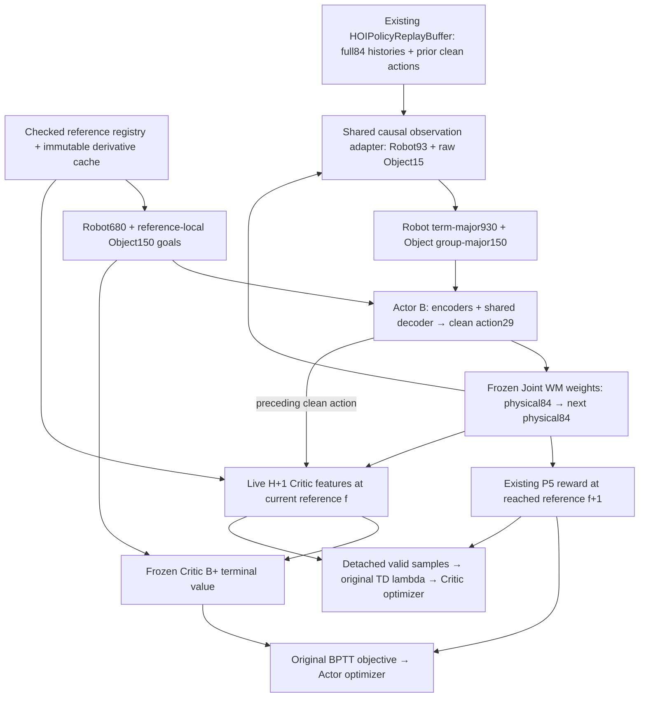

# P7.0.2 + P7.0.3 — Actor B / Critic B+ implementation

Baseline: `db4f71f0325d882bb528072cadd9db08e15946c0`, branch `main`.
Authorization: the user's explicit approval of the P7.0.1 recommendation and
amendments M1/M2. This is architecture/interface implementation and controlled
software validation, not P7-A/B or an executable training lifecycle.

**Acceptance: PASS for the scoped architecture/interface software checks.**
45 new tests and 105 existing regression tests passed; one existing test was
skipped because LAFAN1 data is absent. All eight CPU/CUDA FP32/FP64 compilation
cases completed. This does not authorize P7-A/B or establish physical carrying.
No training or physical rollout is part of this task. One Actor and one Critic
optimizer step in an isolated synthetic unit test check parameter isolation;
they are not policy training.

## 1. Master amendments and preserved scope

[P7_ACTOR_CRITIC_AMENDMENTS.md](P7_ACTOR_CRITIC_AMENDMENTS.md) identifies every
changed section. The complete Master and architecture review were read first;
M1/M2 were applied before source implementation. Master §4.6 now freezes the
separate HOI policy schema. §§1.3.4, 10, 12, 14, 16 and 17 contain narrow
prospective exceptions, including an explicit supersession of the Robot-only
HOI Critic restriction and a cross-reference for legacy P5 interface constraints.
§4.1 now describes the existing absolute Object root-origin linear velocity in
Robot heading axes, without subtracting Robot velocity.

M3/M4/M5 were not applied. Measured force, actual contact, reference contact
intent and geometry-contact observations are excluded from both networks.
WM166→82, physical84/canonical86/support18/action29/xi33, original rewards,
references, assets, solver configuration and P6 calibration are unchanged.
Historical P5/P6 evidence and the P7.0/P7.0.1 reports remain intact.

## 2. Implemented tensor contract

Schema: `hoi-actor-b-critic-bplus-v1`. All histories use ten oldest-to-newest
samples; all goals use ten synchronized frames f...f+9, including f.

| Actor block | Raw width / network |
|---|---|
| Robot history | 930; original term-major order and scales |
| Object history | 150; position30, rotation60, linear30, angular30 |
| Raw observation | 1080 |
| Robot / Object goals | 680 / 150; total 830 |
| Robot encoder | 680→2048→1024→512→256→32, final tanh |
| Object history encoder | 150→128→64; SiLU hidden, linear embedding |
| Object goal encoder | 150→128→64→32; SiLU hidden, final tanh |
| Decoder input | Robot latent32 + Robot history930 + Object history64 + Object goal32 =1058 |
| Shared decoder | 1058→2048→1024→512→256→29; linear native action |

| Critic input slice | Width | Normalization |
|---|---:|---|
| `[0:86]` joint canonical | 86 | Existing JointStateSpec normalization once |
| `[86:104]` support context | 18 | Existing unscaled root/heading representation |
| `[104:119]` Object error | 15 | Divisors (1,1,1,2) by groups (3,6,3,3) |
| `[119:148]` previous clean action | 29 | Original action units |
| `[148:828]` Robot goal | 680 | Original goal scales |
| `[828:978]` Object goal | 150 | Separate frame-major Object scales |
| `[978:1011]` xi | 33 | Original StateSpec context normalization |
| `[1011:1015]` Robot root error | 4 | Original unscaled reference-heading position/yaw |

Critic MLP is 1015→256→128→1 with SiLU hidden layers. Its parameters are entirely
independent of Actor. No optimizer, TD(lambda) recurrence or reward was duplicated.

## 3. Actual data flow



`HOIObservationAdapter.history()` is also the collection-facing pure interface;
this task does not install a physical training environment or history manager.
It consumes the existing Replay rows, with their shared episode/clip/backfill
selection. There is no second physical-state recorder.

Object observation uses each historical state's own actual Robot heading.
`JointStateSpec.object_canonical()` is reused and its scale explicitly undone to
return raw units. Network buffers apply the approved scale once. Adapter
construction rejects changed canonical/xi scale contracts. Object velocity is
absolute world root-origin linear velocity expressed in Robot heading axes;
angular velocity remains Object-body. Quaternion signs are equivalent; rotation6
uses `[R00,R01,R10,R11,R20,R21]`.

Object goals use checked same-clip registry gathers and the existing derivative
cache. Each reference frame supplies its own Robot heading; Object world omega
is converted to reference Object-body omega. Only future goals pad the last
frame. Their mask is retained as `ImagRollout.object_goal_valid`; it never grants
validity to a physical/reward/TD transition. No NPZ is written.

The Robot noise stream draws the original 93 values per frame. Object noise is
explicitly zero in this simulator-state interface. The same functions serve
collection-facing history construction and imagination; no future physical frame
is used to estimate actual velocity. Deployment sensing/noise remains deferred.

After every Joint WM step, the adapter recomputes observations from predicted
physical84 with a live graph. `project_state` and Robot FK remain Robot71-only.
`ImagRollout.goals` stays Robot-only; separate Object goals and incoming clean
actions contain H+1 rows. Padding retains the last state/action but is excluded
from Critic regression. Critic Object errors use reference f_t; reward continues
using f_(t+1). Detached `HOIRolloutContext.record()` diagnostics are not reused.

## 4. Files changed and framework reuse

| File | Change |
|---|---|
| `docs/hoi/force_contact/SMHOI_FORCE_AWARE_IMPLEMENTATION_PLAN.md` | Approved M1/M2 only |
| `docs/hoi/force_contact/p7/IMPLEMENTATION_SPEC.md` | Append current authorization, contracts, tests and scope; preserve P7.0 text |
| `docs/hoi/force_contact/p7/P7_ACTOR_CRITIC_AMENDMENTS.md` | Section-by-section amendment record |
| `docs/hoi/force_contact/p7/P7_ACTOR_CRITIC_IMPLEMENTATION_REPORT.md` | This report |
| `src/supermimic/hoi/policy_features.py` | Named features/slices/scales/schema, reference goals and live Critic input builder |
| `src/supermimic/hoi/policy.py` | Fixed dedicated Actor B and independent Critic B+ |
| `src/supermimic/hoi/policy_checkpoint.py` | Strict named migration and weights-only save/load |
| `src/supermimic/hoi/imagination.py` | Select new dedicated pair, compile numerical adapters when requested, schema metadata |
| `src/supermimic/imagination/rollout.py` | Optional observation/history/Object-goal adapters; explicit Object goal/prior-action/context fields |
| `src/supermimic/imagination/policy_trainer.py` | Optional rollout-aware Critic builder; pass optional adapters to existing recurrence |
| `tests/hoi/p7_policy_fixtures.py` | Full approved networks with reused synthetic coupled WM fixture |
| `tests/hoi/test_policy_features.py` | Frames, layouts, reference identity, scaling, Replay and noise tests |
| `tests/hoi/test_hoi_policy_architecture.py` | Dimensions, sensitivity, BPTT, isolation, boundaries and measurement exclusion |
| `tests/hoi/test_hoi_policy_checkpoint.py` | Named transfer, zero/nonzero fusion distinction, strict rejection and roundtrip |
| `tests/hoi/test_hoi_policy_parity.py` | Inductor forward/backward, features, masks, values and TD parity |
| `tests/hoi/test_hoi_policy_feature_compile.py` | Full-graph compilation of new observation/history/live Critic features and their input gradients |
| `outputs/hoi/contact_supervision/p7_policy_implementation/` | New JUnit and numerical JSON evidence only |

Implementation-level choices within M1/M2: future-goal gathering lives in the
new feature module and calls the unchanged registry/cache, so no reference module
edit is necessary. Policy checkpoint utilities live beside the unchanged WM
checkpoint module. The legacy P5 constructor path remains available for its
existing regression tests; only the dedicated HOIActor/HOICritic pair opts into
the new schema. No original `Policy`, `Critic`, CLI, Trainer lifecycle or defaults
are edited.

## 5. Checkpoint behavior

`migrate_robot_actor` requires the exact original 680-goal/930-history/no-anchor
configuration, strict source keys/shapes/dtype/scales and explicit source hash /
provenance qualification. It copies the Robot encoder and named decoder columns
0:32 and 32:962; columns 962:1058 are zero. Compatible downstream layers and
biases are copied. Original actions are preserved within the declared numerical
tolerance. Initial Object-to-action sensitivity and new encoder gradients are
exactly zero. A separate controlled nonzero-fusion fixture tests connectivity.

`migrate_robot_critic` maps old input blocks 0:71→0:71, 71:751→148:828,
751:784→978:1011, and 784:788→1011:1015. All new columns are zero; there is no
blind prefix copy. Transferred Robot values are explicitly **not calibrated HOI
values**. No old optimizer moments or sampler state are imported.

`hoi-policy-weights-v1` stores strict Actor/Critic schemas and named scale buffers,
separate reference/Object/support identity, provenance qualifications and a
weights-only lifecycle. Both payloads are checked before either network mutates.
Unknown metadata, shape/dtype/key mismatches, altered scales/frames/anchor modes,
nonfinite weights, changed identities and resume payloads are rejected.
`torch.load(..., weights_only=True)` roundtrips are tested in temporary paths.
This is not full training resume; original `sm-train` and joint WM migration are
unchanged. Test source checkpoints/provenance are explicitly synthetic.

## 6. Validation results

Evidence directory:
[p7_policy_implementation](../../../../outputs/hoi/contact_supervision/p7_policy_implementation/).
The machine-readable [summary](../../../../outputs/hoi/contact_supervision/p7_policy_implementation/summary.json)
records suite counts, environment, numerical errors and preservation hashes.
Runs completed on 2026-11-13 with Python 3.12.8, PyTorch 2.14.1+cu130,
CUDA 13.0 and an NVIDIA GeForce RTX 4090 D. No timeout or unfinished compilation
is counted as PASS. No overflow/NaN/Inf warning filter was installed.

### 6.1 Completed suites

| Suite / JUnit artifact | Result | Elapsed seconds |
|---|---:|---:|
| New eager features, architecture, migration / `eager.xml` | 37 passed | 9.753 |
| Existing software regressions / `regression.xml` | 105 passed, 1 skipped | 12.639 |
| End-to-end CPU FP32 / `parity_cpu_fp32.xml` | 1 passed | 642.883 |
| End-to-end CPU FP64 / `parity_cpu_fp64.xml` | 1 passed | 643.464 |
| End-to-end CUDA FP32 / `parity_cuda_fp32.xml` | 1 passed | 582.157 |
| End-to-end CUDA FP64 / `parity_cuda_fp64.xml` | 1 passed | 589.002 |
| New full-graph feature kernels, all four device/dtype cases / `feature_compile.xml` | 4 passed | 97.603 |

Total: **150 passed, 1 skipped**, with no failures/errors. These are unique test
cases in the listed suites, not a claim that every repository test was run.
The skip is `tests/test_motion_library_compact.py::test_compact_matches_full`:
its CUDA + LAFAN1 NPZ prerequisite is unmet because the dataset is absent.
Physical scene/sensor experiments and training/overfit smoke scripts were outside
this task. Existing P5/Robot adapter, Replay, reward, FK, quaternion, objective,
joint WM and migration regressions were included. The original Robot adapter
tests compare noise, actions and Actor gradients against the shared default path.

### 6.2 Numerical and gradient evidence

End-to-end tests use the **full approved Actor/Critic widths**, H=2 and two
starts with valid lengths [2,1]. They compare actions, full physical84 states,
rewards, termination/survival, Robot/Object goals, incoming actions, live Critic
features, values, TD(lambda) targets and every Actor/Critic parameter gradient.
All masks, frames and indices match exactly.

| Device / dtype | Largest absolute difference across compared tensors | Actor-gradient max difference | Critic-gradient max difference |
|---|---:|---:|---:|
| CPU FP32 | 5.9605e-8 | 2.9104e-11 | 4.6566e-10 |
| CPU FP64 | 6.9389e-18 | 3.3881e-20 | 6.9389e-18 |
| CUDA FP32 | 5.0664e-7 | 6.3665e-11 | 2.9802e-8 |
| CUDA FP64 | 3.9040e-16 | 1.4230e-19 | 6.9389e-18 |

Predeclared end-to-end tolerances are FP32 atol/rtol 2e-5/2e-5 and FP64
1e-9/1e-7. Each run executed 87 Inductor graphs. The production adapters compile
the existing HOI step plus new observation/history/live Critic feature builders;
the test additionally compiles both complete networks with `fullgraph=True`.
The full rollout is **hybrid compiled/eager**: existing WM/reward data-dependent
guards and FK MuJoCo enum access cause graph breaks and eager regions. Detailed
compiler counters are retained in each `compiled/parity_*.json`; no single-graph
or throughput claim is made. `suppress_errors=False`; no recompile-limit fallback
occurred. The validation-only specialization allowance is 64, matching P5 practice,
and is restored after each test. No production compiler default was changed.

Separate `fullgraph=True` tests completed for the new pure feature kernels and
state/action input gradients on all four device/dtype combinations. Maximum
absolute differences were 1.9074e-6 in FP32 and 3.5527e-15 in FP64, within
predeclared feature tolerances 5e-6/5e-6 and 1e-10/1e-8. This establishes that
the new feature kernels themselves do not require graph breaks.

| Acceptance concern | Completed evidence |
|---|---|
| Dimensions/representation | Every named slice and flatten order; Actor1080/830/1058/29, Critic1015, unchanged WM166→82; per-frame headings and absolute linear/body angular conventions |
| Replay/reference | Shared Robot/Object Replay rows; reset backfill; episode/clip boundaries; original/candidate and multiple clips; f...f+9 goals, goal-only padding, hash mismatch rejection and NPZ immutability |
| Feature numerics | Quaternion sign invariance, heading equivariance, zero reference error, normalization exactly once and finite orientation gradients including tested near-half-turn cases |
| Object sensitivity | Independent position/orientation/linear/angular/goal perturbations change named features; controlled nonzero fusion gives finite nonzero Object-to-action Jacobians and both Object encoder gradients |
| Live imagination | Newly predicted Object states update later observations; gradients traverse those states; H+1 Critic uses f_t, prior clean actions and live support/Object errors |
| Critic | Named Object/support/action/goal perturbations and controlled value/input gradients; invalid padded rows excluded from TD regression |
| Boundaries/exclusions | Natural end, timeout, failure and mixed boundary cases preserve existing bootstrap semantics; adversarial measured force/contact sidecars do not change policy/reward/value/TD/Actor gradients |
| Update isolation | Actor step changes Actor only; Critic step changes Critic only; WM optimizer steps zero; frozen flags restore after an exception |
| Migration | Strict FP32/FP64 mapping, scale/schema/dtype/shape/key/identity rejection, atomic load rejection, zero-fusion and controlled nonzero-fusion tests, temporary-file weights-only roundtrip |

`eager/terminal_gradient.json` records an isolated terminal Object value path
through the frozen coupled WM: Object terminal-state gradient norm **0.4342753**,
Actor gradient norm **1.9473e-4**, finite-difference absolute error **2.9518e-11**.
Detaching the Object path gives zero in the negative control. A separate test
checks the terminal previous-action path. This uses a synthetic coupled dynamics
fixture, not a learned WM; it proves connectivity, not physical model fidelity.

Migration max action/value differences were 1.1642e-10 / 3.9116e-8 in FP32 and
2.1684e-19 / 2.7756e-17 in FP64, within migration tolerances 5e-7/5e-6 and
1e-12/1e-10. **Zero fusion gave exactly zero initial Object sensitivity and
Object encoder gradients.** Separate nonzero-fusion fixtures produced Object
history/goal encoder gradient norms 9.0766e-6 / 1.5255e-6 (FP32) and
1.5226e-5 / 2.8098e-6 (FP64). These are distinct initialization tests.

### 6.3 Reproducible commands

Run from the repository root. The commands below reproduce the retained suites;
each end-to-end device/dtype case was executed in a separate process.

```bash
OMP_NUM_THREADS=1 MKL_NUM_THREADS=1 \
P7_POLICY_EVIDENCE_DIR=outputs/hoi/contact_supervision/p7_policy_implementation/eager \
.venv/bin/python -m pytest \
  tests/hoi/test_policy_features.py tests/hoi/test_hoi_policy_architecture.py \
  tests/hoi/test_hoi_policy_checkpoint.py -q \
  --junitxml=outputs/hoi/contact_supervision/p7_policy_implementation/eager.xml

for p7_device in cpu cuda; do
  for p7_precision in fp32 fp64; do
    OMP_NUM_THREADS=1 MKL_NUM_THREADS=1 TORCHINDUCTOR_COMPILE_THREADS=1 \
    P7_POLICY_EVIDENCE_DIR=outputs/hoi/contact_supervision/p7_policy_implementation/compiled \
    .venv/bin/python -m pytest tests/hoi/test_hoi_policy_parity.py \
      -q -k "$p7_precision and $p7_device" \
      --junitxml="outputs/hoi/contact_supervision/p7_policy_implementation/parity_${p7_device}_${p7_precision}.xml"
  done
done

OMP_NUM_THREADS=1 MKL_NUM_THREADS=1 TORCHINDUCTOR_COMPILE_THREADS=1 \
P7_POLICY_EVIDENCE_DIR=outputs/hoi/contact_supervision/p7_policy_implementation/compiled \
.venv/bin/python -m pytest tests/hoi/test_hoi_policy_feature_compile.py -q \
  --junitxml=outputs/hoi/contact_supervision/p7_policy_implementation/feature_compile.xml

OMP_NUM_THREADS=1 MKL_NUM_THREADS=1 .venv/bin/python -m pytest \
  tests/hoi/test_box_tracking_reward.py tests/hoi/test_checkpoint_migration.py \
  tests/hoi/test_force_aggregation.py tests/hoi/test_force_replay.py \
  tests/hoi/test_geometric_contact_reward.py tests/hoi/test_imagination_boundaries.py \
  tests/hoi/test_joint_architecture.py tests/hoi/test_joint_world_model.py \
  tests/hoi/test_p5_validation.py tests/hoi/test_policy_adapter.py \
  tests/hoi/test_quaternion_reward_numerics.py tests/hoi/test_reward_reference.py \
  tests/hoi/test_support_context.py tests/hoi/test_wm_reuse.py \
  tests/test_g1_fk.py tests/test_motion_library_compact.py \
  tests/test_world_model.py::test_state_spec_identity_and_errors \
  tests/test_imagination.py::test_gae_targets_match_hand_computation -q \
  --junitxml=outputs/hoi/contact_supervision/p7_policy_implementation/regression.xml
```

Ruff checks pass for the three new source modules, three modified shared source
files and six new test/fixture files. `git diff --check` passes. No blanket
formatting of the original shared source was performed.

### 6.4 Preservation audit

SHA256 comparison against the initial 3,090 tracked-file snapshot found exactly
the five intended modified tracked files listed in §4: Master, P7 specification,
HOI trainer adapter and the two shared imagination files. The other **3,085
tracked files are byte-identical**, including original Robot networks/defaults,
the `sm-train` loader, joint WM/migration, physical assets, solver configuration,
references, P6 calibration and historical reports. The preexisting untracked
`.vscode/` directory was untouched. New files are the explicitly listed modules,
tests, reports and evidence. Git index remains empty and HEAD remains the baseline.

| Protected artifact | Unchanged SHA256 |
|---|---|
| Original HDMI NPZ | `bbbb40a49ccdd47f474bf43f75260a91361eac2ab3f3d9e54574d206996ad61b` |
| `reference_candidate_v1` NPZ | `f38071e5347403f9eff993dd37884bf374e0c003400156dc4cb87d3d2b856cb0` |
| P6 contact calibration | `34a47e06454c64f71b456bb428110fceff65302f6c6517dc85a95e151d400266` |

The candidate remains experimental with `training_ready=false`. No physical
rollout, solver-guard activation test, training, PPO, commit or push was performed.

## 7. Remaining P7.0.4 integration requirements

1. Wire the shared observation/goal adapters into actual physical collection,
   per-environment resets and observation histories; install policy-capable Replay.
2. Build the dedicated `smHOI-track` component construction and reuse `Trainer.run()`;
   do not create another loop. This task adds no executable training lifecycle.
3. Complete whole-system checkpoint/resume for WM, all optimizers, history,
   Replay, sampler, RNG, schedule and provenance. Current policy utilities are
   explicitly weights-only initialization.
4. Integrate candidate-aware reset/termination/evaluation, overflow and NaN/Inf
   fail-fast monitoring, and attest the opt-in precision guard inside that actual
   process. Software compilation here does not establish solver activation.
5. Preserve `reference_candidate_v1`'s hash and `training_ready=false`, baseline
   contact parameters, original intent and independent physical diagnostics.
6. Resolve or explicitly bound existing reset/physical evidence limitations.
   P7-A learned WM readiness remains required before useful policy BPTT; the
   synthetic coupling fixture is not learned action-to-Box dynamics.
7. After separate authorization, evaluate actual learned-policy Object use and
   physical A–F outcomes. No tracking-only, high-force or synthetic-gradient
   result establishes carrying success. Native PD failures remain P6 open issues.

Do not automatically begin these integration tasks, P7-A/B, PPO or training.
No commit or push is authorized by this implementation task.
